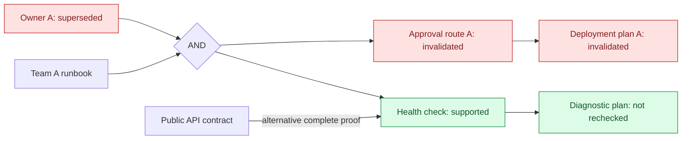

# Revisyn

### The fact changed. The cached plan did not.

[](https://github.com/DebasishMaji/Revisyn/actions/workflows/ci.yml)
[](pyproject.toml)
[](LICENSE)
[](docs/research.md)

An agent learns who owns a service, derives an approval route, and saves a
deployment plan. Ownership changes. Retrieving the new owner does not, by itself,
retire the old plan.

**Revisyn tracks which evidence versions justify a memory.** When that evidence
is replaced or withdrawn, it blocks reuse of conclusions that have lost every
declared proof. Conclusions with another complete proof remain available.

Python 3.11+ | Standard-library core | Optional LangGraph integration | macOS and Linux

> [!IMPORTANT]
> Research alpha. Dependencies must be supplied by your application.
> "Supported" means supported by the declared graph, not verified true in the
> world. Revisyn is not automatic dependency extraction or model unlearning.

[Run the demo](#see-what-changes-and-what-survives) |
[LangGraph integration](docs/langgraph.md) |
[Use the API](#bind-a-plan-to-its-evidence) |
[Understand the graph](#proofs-not-just-parent-links) |
[Evaluate the fit](#when-is-this-worth-integrating)

## Updating a fact is not the same as updating its consequences

After a service transfers from team A to team B, the old owner revision no
longer supports the old approval route. The deployment plan loses its proof.
But a public API contract still justifies the health check:



The new owner does not silently replace the old reference inside an existing
proof. Rebuilding the deployment plan requires a new, explicit derivation.
An unchanged health check stops propagation to its diagnostic descendant.

## See what changes, and what survives

With [uv](https://docs.astral.sh/uv/) installed:

```sh
git clone https://github.com/DebasishMaji/Revisyn.git
cd Revisyn
uv sync --locked
uv run python examples/memory_retraction.py
```

**No API key, model, or external service.** The demo changes ownership, attempts
stale reuse, reopens the database, and explicitly derives a replacement plan.
Selected lines from the run:

```text
Invalidated: approval-route, deploy-plan
Support checks: 3; checked memories retaining another proof: 1
Blocked reuse: Memory 'deploy-plan' is invalidated.
Health check remains supported by: public-health-contract
The downstream diagnostic plan was not rechecked.
```

Reopening the store does not restore the old plan. The example then creates a
new approval route and deployment plan from team B's evidence.

To retain the database, add `--directory ./memory-demo`. The directory must be
new; existing paths are rejected rather than overwritten.

### Compare four policies on the same change

```sh
uv run revisyn lab > comparison.json
```

In the included **complete-provenance** fixture:

| Policy | Incorrect plans reused | Valid plans unnecessarily blocked | Support checks |
|---|---:|---:|---:|
| Latest-record reuse | 1 | 0 | Not counted |
| Blanket descendant invalidation | 0 | 2 | Not counted |
| Full proof recomputation | 0 | 0 | 4 |
| Revisyn selective maintenance | 0 | 0 | 3 |

Full recomputation is the correctness reference, not a strawman. Revisyn matches
its reuse decisions while avoiding the unchanged diagnostic descendant.

These are counts from a small, fixed fixture, not a latency or scalability
benchmark. The unit is **stored-plan reuse**, not executed deployments or model
accuracy. Support checks are policy evaluations, not SQL query counts.

> [!WARNING]
> The laboratory also removes a required ownership dependency. Both Revisyn and
> full recomputation then reuse the wrong deployment plan. A graph-maintenance
> engine cannot repair evidence that was never declared.

The independent world-state oracle keeps that failure visible. Exit 0 means the
comparison completed, not that every policy passed. See the
[laboratory contract](docs/laboratory.md) for fixtures, scoring, and counting rules.

## Guard memory retrieval in LangGraph

The optional integration exposes selected keys through an async LangChain tool.
The application selects the store, namespace, and exposed keys; the model can
request a key but cannot switch namespaces or use historical inspection.

```sh
uv sync --locked --extra langgraph
uv run --extra langgraph python examples/langgraph_memory.py
```

The example uses a **real compiled graph** with a fresh-retrieval gate. The old
plan remains in the conversation, but its next retrieval returns `blocked`
without its content after ownership changes. An independently supported health
check remains available. Tool choices are scripted; no model is called.
It also pauses after a supported retrieval, changes the evidence, and resumes.
The reuse gate rechecks the exact current reference instead of trusting the
checkpoint's formerly supported response.

This does not erase prior context or lock evidence across later actions. The
application must enforce its reuse gate. See the [integration guide](docs/langgraph.md)
for the response contract and async ownership requirements. Core imports remain
independent of LangGraph.

## Bind a plan to its evidence

The integration below expects a new database or unused keys:

```python
from revisyn import MemoryStore, UnsupportedMemory

with MemoryStore("memory.sqlite3", namespace="orders-agent") as memory:
    owner = memory.observe(
        "service-owner", {"team": "A"}, source="service-catalog/revision-1"
    ).memory
    plan = memory.derive(
        "deployment-plan",
        {"request_approval_from": "A"},
        supports=((owner.ref,),),
        rule="deployment-routing/1",
    ).memory

    change = memory.observe(
        "service-owner",
        {"team": "B"},
        source="service-catalog/revision-2",
        replaces=owner.ref,
        reason="Ownership transferred.",
    )
    assert plan.ref in change.invalidated

    try:
        memory.recall("deployment-plan")
    except UnsupportedMemory:
        print("The old plan needs a new derivation, not another retrieval.")

    explanation = memory.explain(plan.ref)
    print(explanation.target.state)
```

Replacement requires the exact current reference in `replaces`. A stale writer
gets `RevisionConflict`, rather than silently overwriting a newer observation.
Re-observing a withdrawn fact does not reactivate conclusions bound to its old
revision, even if the content looks identical.

## Proofs, not just parent links

A conclusion can require several premises and still have an independent
alternative:

```python
supports = ((catalog.ref, runbook.ref), (public_contract.ref,))
```

```text
(catalog AND runbook) OR public contract
```

Each inner tuple is a complete proof requiring **every** premise. Any surviving
complete proof is sufficient. This avoids both stale reuse and indiscriminate
invalidation of conclusions with independent support.

| Change field | Meaning |
|---|---|
| `invalidated` | Descendants that lost every declared proof. |
| `rechecked` | Memories whose support was evaluated during propagation. |
| `preserved` | Rechecked memories that retained a complete proof, not every unaffected memory. |

Proofs reference immutable revisions, not whichever value a logical key happens
to hold later. Revision history and proof dependencies are separate relationships.

### Read supported content; inspect historical content

| API | Purpose |
|---|---|
| `recall(key)` | Return a supported current revision or raise explicitly. |
| `recall(key, expected_ref=saved.ref)` | Require that exact revision to remain current and supported. |
| `recall_many(keys)` | Return all requested supported current revisions from one consistent read view, or raise. |
| `get(ref)` | Inspect a specific historical revision, including unsupported content. |
| `memories()` | Inspect current records, including unsupported ones; `include_history=True` adds older revisions. |
| `history(ref)` | Inspect state transitions and their initiating cause. |
| `explain(ref)` | Read the target, declared ancestors, and their histories in one consistent snapshot. |
| `list_memories()` / `list_events(ref)` | Bounded, sequence-cursor pages for operator inspection. |

**Use `recall` to gate reuse.** Historical lookup is intentionally not a
substitute: preserving an invalidated record for audit does not make it safe to
feed back into an agent.

Use `expected_ref` when reusing a saved or checkpointed response: a supported
replacement raises `RevisionConflict` instead of silently substituting different
content. Reference and support checks share one read transaction, not a lock
across a later action. See the [reuse precondition](docs/semantics.md#guarded-reuse-of-a-saved-revision)
for error precedence and concurrency limits.

For a decision requiring several memories, use `recall_many(("owner", "plan"))`
instead of assembling separate reads that can straddle an evidence update.
It preserves input order and fails without a partial result if any key is
missing or unsupported. See [batch retrieval](docs/semantics.md#read-related-memories-together)
for snapshot, reference, and concurrency limits.

### Operate a controlled worker without reviving stale history

After deliberate provisioning, `MemoryStore(path, namespace=..., require_existing=True)`
rejects missing or uninitialized state. `read_only=True` opens an existing store
without migration or writes; fresh per-call reads still see later evidence changes.

```sh
uv run revisyn list memory-demo/memory.sqlite3 --namespace orders --limit 100
uv run revisyn status memory-demo/memory.sqlite3 --namespace orders
uv run revisyn snapshot memory-demo/memory.sqlite3 \
  --out memory-demo/incident.sqlite3
```

Full-database archives preserve all namespaces and plaintext content. They can
be audited read-only, but writable stores and `recall` reject them: an archived
"supported" plan is not current operational evidence. See the
[embedded-worker runbook](docs/operations.md) for privacy, atomic publication,
pagination, and recovery boundaries. This remains a research alpha.

## When is this worth integrating?

Consider it when your application already knows which evidence produced a
summary, procedure, or plan, and needs to withdraw derived content without
discarding everything else. The useful boundary is between **evidence changing**
and **old conclusions being reused**.

| Revisyn handles | Your application must supply |
|---|---|
| Immutable revisions and guarded replacement | Logical keys, source updates, and source authority. |
| Selective invalidation across declared AND/OR proofs | Required dependencies and sound derivation rules. |
| Supported-current-revision retrieval | Retrieval gating and rechecks before consequential use. |
| Durable causal history and explanations | Authentication, access control, and data-retention policy. |

It is the wrong starting point if you need automatic conversational fact
extraction, vector search, a complete retrieval-augmented generation system, or
guaranteed removal of information from a model.

### Important boundaries

| Boundary | Current contract |
|---|---|
| Correctness | Support is relative to declared evidence; missing dependencies can leave stale plans available. |
| Graph | New derivations reference existing revisions; no stored cycles, recursive rules, or negative premises. |
| Atomicity | Revision changes, invalidation, and causal events commit together in SQLite. |
| Deployment | Local storage, one connection per thread; SQLite serializes writes. Not a distributed memory service. |
| Privacy | Content and provenance are plaintext. New files are owner-only; existing permissions are unchanged. Do not store credentials. |

Retraction does not erase tokens already in a model's context, invalidate an
unrelated cache, cancel an agent already acting, or undo an external effect.
Nor does Revisyn authenticate a source, prove a rule sound, or infer equivalent
logical keys.

## Design and research

**Question:** can explicit provenance reduce incorrect reuse of derived agent
memories after evidence changes, without unnecessarily discarding valid plans?

Truth maintenance and incremental view maintenance predate agent memory.
Revisyn does not claim a new belief-revision algorithm. The included laboratory
and generated-graph cases establish a starting point, not comparative model
results or evidence of production adoption.

| Read next | Contract |
|---|---|
| [LangGraph integration](docs/langgraph.md) | Exposed keys, guarded tool responses, graph gates, and ownership constraints. |
| [Semantics](docs/semantics.md) | Revisions, transactions, support propagation, history, and failure behavior. |
| [Operations](docs/operations.md) | Read-only operators, fail-closed startup, inspection archives, and recovery safeguards. |
| [Laboratory](docs/laboratory.md) | The versioned ownership-transfer fixture and independent oracle. |
| [Research gates](docs/research.md) | Prior art, missing-provenance experiments, and evaluation requirements. |
| [Implementation](src/revisyn/store.py) | The SQLite backend and selective maintenance logic. |

[Aegentra](https://github.com/DebasishMaji/Aegentra) addresses a different
boundary: unresolved external tool effects. Revisyn addresses evidence and
retrieval. No automatic integration between the libraries is included.

## Contributing

```sh
uv sync --locked --extra langgraph
uv run --extra langgraph pytest
uv run --extra langgraph ruff check .
uv run --extra langgraph ruff format --check .
uv run --extra langgraph mypy
uv build
```

Cases cover rollback during invalidation, subprocess crashes, concurrent
replacement conflicts, consistent explanations, deep proof chains, and agreement
with independent full recomputation. Read [CONTRIBUTING.md](CONTRIBUTING.md)
before changing proof semantics or experimental claims.

An integration that exposes missing provenance is valuable evidence, not a
failure to hide.

Licensed under [Apache 2.0](LICENSE). See [NOTICE](NOTICE).